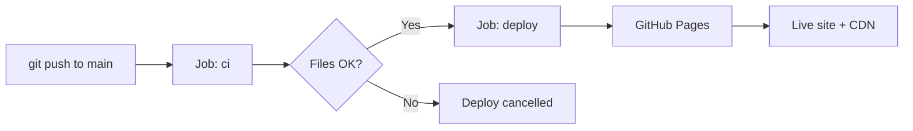

# 🧠 Проект «Осязание»

> Сайт, который себя осознал и теперь деплоится сам.

## 🔗 Прямые ссылки

- 🌐 **Сайт:** https://Evgeny65ok.github.io/hello-pagesOsazanie/
- 🚀 **Deployments:** https://github.com/Evgeny65ok/hello-pagesOsazanie/deployments
- ⚙️ **Environments:** https://github.com/Evgeny65ok/hello-pagesOsazanie/settings/environments

## 👥 Команда «Осязание»

| Роль | Имя | Фишка |
|------|-----|-------|
| 👑 Тимлид | Евгений Белевитин | Говорит «это быстро» |
| ⚙️ DevOps | Кирилл Мамаев | Его боится YAML |
| 💻 Программист 1 | Влад Дербенцев-Федосов | Коммитит в пятницу |
| 🐛 Программист 2 | Иван Потапов | «У меня локально работает» |

## 📄 Страницы

- [x] 🏠 Главная (`index.html`) — Женя
- [ ] 👽 О нас (`about.html`) — Кирилл
- [ ] 💸 Услуги (`services.html`) — Влад
- [ ] 📝 Блог (`blog.html`) — Влад
- [ ] 📞 Контакты (`contacts.html`) — Иван

## 🛠 Стек

- HTML5 + CSS3 + JavaScript (vanilla)
- GitHub Actions (CI/CD)
- GitHub Pages (хостинг + CDN)

## 📊 Схема CI/CD



## 🎮 Пасхалка

На сайте нажми: **↑ ↑ ↓ ↓ ← → ← → B A** — и увидишь магию.

## 🚀 Как обновить

```bash
git add .
git commit -m "feat: ..."
git push origin main
```

Через 1–2 минуты изменения на живом сайте.